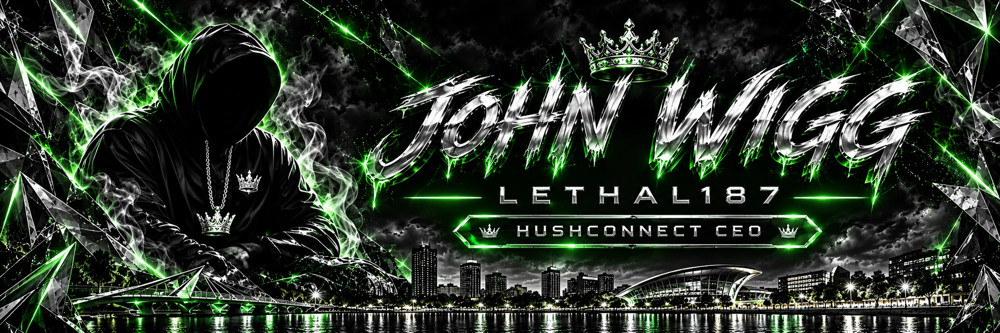

# YouTube Discord Presence

Lethal's YouTube bot shares the video currently playing in Brave as a Discord **Listening** activity, with its title, channel or artist, artwork, watch link, and elapsed/remaining time. It supports YouTube watch pages, the active YouTube mini-player while browsing playlists, and YouTube Music.

## A project in development

Hush Connect is in development. It is still being built, and we look forward to sharing more when it is ready.

This repository contains the extension and bridge source. Local pairing codes and runtime paths are created on each computer and are not included in the public repository.

## Requirements

- Windows, Discord desktop, Brave, and Node.js 22 or newer.
- A Discord application ID. The application name supplies the activity branding.
- No npm packages, Discord account token, bot token, or YouTube credentials are required.

## Fresh setup

Do not run a second bridge beside an existing installation: both use port 32145.

1. Create or select your Discord application in the [Discord Developer Portal](https://discord.com/developers/applications) and copy its public Application ID.
2. Run `Setup.cmd`. It creates an independent private pairing code and local runtime configuration. Existing configuration is never overwritten automatically.
3. Start Discord desktop, then run `Start.cmd`.
4. Open `brave://extensions`, enable Developer mode, choose **Load unpacked**, and select this repository's `extension` folder.
5. Open the extension options, paste the locally generated pairing code, enable **Share playing videos**, and select **Save and check connection**.
6. Refresh already-open YouTube or YouTube Music tabs once, then play a video or track and check your Discord profile.

`bridge/config.example.json` documents the local configuration shape. Real `bridge/config.json` and `runtime.txt` are generated locally and ignored by Git.

## Automatic startup on Windows

First complete **Fresh setup** and run `Start.cmd` once to confirm the bridge connects to Discord. Then run `Install-Autostart.cmd`. This registers a Windows Task Scheduler task for the current user, starts the bridge when that user signs in, and retries up to three times after an unexpected exit. It does not run as administrator or store a Windows password.

Discord desktop must be open in the same signed-in Windows session for the activity to appear. The PC must be on and awake. To remove automatic startup, run `Uninstall-Autostart.cmd`. This removes the scheduled task; it does not remove the extension pairing or local configuration.

## Development

Run `npm test` for the seven focused playback, timestamp, RPC, and authenticated local HTTP tests. Run `npm run check` for JavaScript syntax checks. No dependency installation is needed. If npm is unavailable, run `node --test bridge/test.js test/player.test.js` directly; syntax can be checked with `node --check` for each JavaScript file.

| Location | Purpose |
| --- | --- |
| `extension/player.js` | Reads active YouTube and YouTube Music player metadata in the page world |
| `extension/content.js` | Validates and forwards playback snapshots |
| `extension/background.js` | Sends paired updates to the local bridge |
| `extension/options.*` | Local pairing and sharing controls |
| `Install-Autostart.ps1`, `Uninstall-Autostart.ps1` | Current-user Windows Task Scheduler setup and removal |
| `bridge/server.js` | Playback selection and local HTTP service |
| `bridge/rpc.js` | Discord named-pipe RPC connection and recovery |
| `bridge/test.js`, `test/player.test.js` | Offline verification with mock playback and local transports |
| `docs/maintenance.md` | Troubleshooting and safe deployment workflow |

## Behaviour and limits

- Pausing, ads, or closing YouTube clears the activity after the stale-playback window, normally within about 20 seconds.
- Separate Discord application IDs allow music to coexist with other activities. This bridge does not suppress music while a Kick stream is live. Discord controls which activity appears first.
- Incognito is excluded by default. Supported sites are `https://www.youtube.com/` and `https://music.youtube.com/` in desktop Brave. This does not add iPhone reporting; iOS Brave cannot load this desktop extension.
- The bridge listens only on `127.0.0.1:32145`, requires the local pairing code, and rejects ordinary website origins. That code is a local secret, not a Discord credential.
- Sharing makes the playing title and channel visible to people who can view your Discord activity.

## Repository privacy

`private: true` in `package.json` prevents accidental npm publication; it does not make this GitHub repository private. Pairing codes, generated configuration and local runtime paths are ignored by Git. No reuse license has been added.
